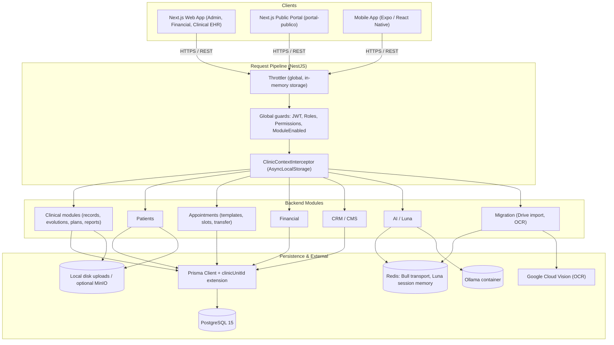

# CPAE Healthcare Ecosystem — Architecture Case Study


> **Architectural case study of a production multi-unit clinical management platform: Electronic Health Records (EHR), advanced scheduling, financial operations, a public portal, and a self-hosted AI assistant (Luna). Built with NestJS, Next.js, Prisma, PostgreSQL, Redis/Bull queues, local-disk storage with optional MinIO, and Ollama.**

---

## Private Source Notice

```
Production source code is proprietary and confidential due to clinical operations
and sensitive healthcare privacy regulations (Brazilian LGPD standards).
This public repository contains sanitized architecture documentation, design patterns,
data flow specifications, and engineering trade-offs.
No proprietary code, API secrets, or clinical patient records are published here.
```

This documentation was re-aligned with the source code. Controls that are still being implemented are listed explicitly as a hardening roadmap (section 7) and are not described as existing behavior.

---

## 1. Executive Summary & Ecosystem Overview

**CPAE (Centro Psicopedagógico e Apoio Emocional)** is a multidisciplinary healthcare and educational organization operating in production at [sistema.clinicacpae.com.br](https://sistema.clinicacpae.com.br). The ecosystem has these parts:

| Pillar | Service / Subsystem | Purpose & Technologies |
|---|---|---|
| **Clinical Core & EHR** | `sistema.clinicacpae.com.br` | Electronic health records, clinical modules (anamnesis, daily evolutions, clinical opinions, therapeutic plans, monthly/semester reports, family feedback, school partnerships, session guides), advanced scheduling, and financial operations. **NestJS, Next.js, PostgreSQL, Prisma, Redis/Bull.** |
| **Public Portal** | `portal-publico` | Institutional public portal built with **Next.js**. Public content and blog are served by the backend `cms` module. |
| **CRM & Lead Intake** | `crm` module | Leads, lead interactions, questionnaire responses, and a rate-limited public quiz endpoint. Automatic routing of leads to specialists is not claimed. |
| **Self-Hosted Assistant (Luna)** | `ai` module | Internal assistant with orchestrator, router, sandboxed tools, guardrails, redaction, session memory and usage budget. Text inference runs through Ollama in a container. See section 6. |
| **Mobile Client** | `mobile` | **React Native / Expo** companion app for staff and clinicians. There is no patient login. |

---

## 2. Engineering Role & Ownership (Solo Architect & Engineer)

As primary architect and lead engineer I designed and developed the platform:

1. **Full-stack development:** NestJS backend API, Next.js administrative and clinical web application, public portal, and Expo mobile app.
2. **Multi-unit architecture:** data segregation keyed by `clinicUnitId` (`ClinicUnit`, `UserClinicUnit`, `PatientClinicUnit`), enforced through a Prisma Client extension, combined with role- and module-level access control.
3. **Advanced scheduling:** weekly schedule templates, operational slots and exceptions, conflict detection, and a preview-first agenda transfer workflow (section 5).
4. **Financial module (v1.2):** transactions, categories, professional payment rules, payment proofs, duplicate-payment blocking and a monthly checklist (section 6).
5. **Asynchronous pipeline:** Bull/Redis queues for the legacy-data migration pipeline (Google Drive import and OCR of legacy documents).
6. **Storage:** `StorageService` with MinIO and an automatic fallback to private local disk; clinical photos and attachments are currently written to local disk.
7. **Privacy and LGPD controls:** consent tracking (`PatientConsent`) and audit/access trails (`AuditLog`, `AccessLog`) on sensitive clinical, scheduling and financial operations.
8. **Self-hosted AI:** Luna performs text inference through Ollama (default models `gemma3:4b` and `qwen2.5:1.5b`) in a container of the production compose stack.
9. **DevOps:** Docker Compose production stack (PostgreSQL, Redis, MinIO, Ollama, backend, frontend). Reverse proxy and backup scheduling belong to the operations layer, which is outside the scope of this case study.

---

## 3. High-Level System Architecture



---

## 4. Multi-Unit Data Isolation & Access Control

### 4.1 Multi-unit scoping by `clinicUnitId`
- The ecosystem supports multiple facilities through `ClinicUnit`; users and patients are linked through `UserClinicUnit` and `PatientClinicUnit`.
- The active unit travels with the authenticated user (JWT). A global `ClinicContextInterceptor` stores it in `AsyncLocalStorage`, and a Prisma Client extension (`$extends`) injects the `clinicUnitId` filter into queries of the models that belong to a unit.
- Administrative routines can opt into an explicit bypass. Coverage is defined by an explicit list of unit-scoped models, so models outside that list are not filtered automatically.
- There is no `tenantId` and no tenants module: the isolation unit is the clinic unit inside one shared database.

### 4.2 Roles and module permissions
Eight roles: `ADMIN`, `OWNER`, `FINANCIAL_ADMIN`, `FINANCIAL_VIEWER`, `COORDINATOR`, `RECEPTIONIST`, `PROFESSIONAL`, `MARKETING`. They combine with per-user module permissions (`UserModulePermission`) and four global guards (JWT, Roles, Permissions, ModuleEnabled). Endpoints declare allowed roles with `@Roles(...)`. There is no patient login or patient self-service portal.

---

## 5. Scheduling: Templates, Slots and Agenda Transfer

- **Weekly model:** `ScheduleTemplate` with items and tracked applications, `OperationalSlot`, slot exceptions, clinic closures and professional shifts. Templates can be imported from a weekly spreadsheet.
- **Agenda transfer and professional substitution:** `POST appointments/transfer-agenda/preview` computes affected sessions and conflicts without writing; `POST appointments/transfer-agenda` executes. Both endpoints are restricted to `ADMIN` and `RECEPTIONIST`.
- **Conflict policy:** `onConflict` is `ABORT`, `SKIP` or `FORCE`. `FORCE` is restricted to `ADMIN` and `OWNER` and requires explicit confirmation plus a written reason; the frontend hides the option from reception.
- **Conflict export:** the frontend builds a CSV of conflicts (UTF-8 with BOM, semicolon separator, CRLF) for spreadsheet review.
- Covered by unit tests and a Playwright spec (see `docs/testing.md`).

---

## 6. Financial v1.2, Clinical Modules, CMS/CRM/Marketing and Luna

**Financial v1.2.** `FinancialTransaction`, `FinancialCategory`, `ProfessionalPaymentRule` and `PaymentProof`. Payout flows take a pessimistic row lock to prevent concurrent payouts, block duplicate payments, and expose a monthly value checklist; the frontend adds filters on top. There is no `Invoice` model.

**Clinical modules.** Anamnesis (versions and addenda), clinical opinions, daily evolutions, therapeutic plans, monthly and semester reports, family feedback, school partnerships, session guides, genealogy, activity photos, and clinical record versions and drafts.

**CMS, CRM and Marketing.** `cms` (blog and public content), `crm` (leads, interactions, questionnaire responses, public quiz) and the `MARKETING` role.

**Legacy migration.** The `migration` and `google-drive` modules import legacy material through Bull queues (`drive-import`, `ocr-processing`). OCR uses Google Cloud Vision (`document-processing`). `tesseract.js` is still listed as a dependency but is not used by application code.

**Luna.** Internal assistant composed of an orchestrator, a router, tools executed in a sandbox, guardrails, a redaction service, session memory in Redis, a usage budget and cache, and a workbench. Reliability is tracked with golden routing tests, adversarial and isolation/RBAC specs, and opt-in handling of sensitive capabilities. Text inference runs through Ollama in a container of the production compose stack. OCR calls Google Cloud Vision, so no claim is made that data never leaves the infrastructure.

---

## 7. Security, Privacy & LGPD

- **Consent (`PatientConsent`):** consent records used by clinical records, patients and activity photos.
- **Audit and access trails:** `AccessLog` entries on clinical-record operations; `AuditLog` entries on selected scheduling, permission, staff and financial operations. Not every access is logged.
- **Storage:** see `docs/architecture.md`. Read URLs generated by `StorageService` currently last 24 hours.
- **Authentication:** JWT; `bcrypt` with 10 rounds; global rate limit of 100 requests per minute and a per-account failed-login limit.

### Hardening roadmap (in progress)
These items are being changed in the codebase and are **not** described as existing behavior:

| Area | Current state | Target |
|---|---|---|
| Audit trail | `AuditLog` is written synchronously and rows can be deleted when a user is removed | Immutable audit trail |
| Presigned URLs | Read URLs last 24 hours | 15-minute expiry |
| Login throttling | Global 100 req/min and a per-account failure limit; no per-IP login limit | Per-IP login limit |
| PII in logs | No request-logging redaction layer; redaction exists only in the AI layer | PII redaction in application logs |

---

## 8. Engineering Deep Dives & Documentation

- [**System Architecture & Service Boundaries**](./docs/architecture.md) — Modules, unit isolation, storage.
- [**Technical Decisions & Trade-Offs**](./docs/technical-decisions.md) — NestJS, Prisma, storage and queue choices.
- [**Data Flow & State Lifecycle**](./docs/data-flow.md) — Patient intake, attachments, migration pipeline.
- [**Security & Healthcare Compliance**](./docs/security.md) — Roles, current controls and hardening roadmap.
- [**Testing & Verification Strategy**](./docs/testing.md) — Jest, Supertest, Playwright, audit scripts.

---

## 9. Technology Stack

| Domain | Technology | Production Package | Role |
|---|---|---|---|
| **Backend Framework** | NestJS 11 | `@nestjs/core`, `@nestjs/common` | Modular monolith (34 Nest modules) |
| **Language** | TypeScript 5.7 | `typescript` | Strict type safety |
| **ORM** | Prisma 6.19 | `@prisma/client`, `prisma` | 79 models, 32 enums |
| **Primary Database** | PostgreSQL 15 | `pg` | Relational persistence |
| **Queue Engine** | Bull 4.16 | `bull`, `@nestjs/bull` | Migration pipeline (Drive import, OCR) |
| **Redis** | Redis | `ioredis` | Bull transport and Luna session memory |
| **Object Storage** | Local disk + MinIO SDK 8 | `minio` | Disk fallback; MinIO optional |
| **Documents** | pdf-lib / docx | `pdf-lib`, `docx` | Report generation |
| **OCR** | Google Cloud Vision | Cloud service | Legacy document OCR |
| **Frontend** | Next.js 16 / React 19 | `next`, `react` | Web UI |
| **Styling** | Tailwind CSS v4 | `tailwindcss` | Design system |
| **Mobile** | Expo | `react-native`, `expo` | Staff and clinician app |
| **Containerization** | Docker Compose | `docker-compose.prod.yml` | db, redis, minio, ollama, backend, frontend |
| **Local LLM** | Ollama | `gemma3:4b`, `qwen2.5:1.5b` defaults | Luna text inference |

---

## 10. License & Credits

- Architectural documentation: **CC-BY-NC 4.0**
- Architect & Lead Implementer: **Leonardo Santana** ([@leonardosantana214](https://github.com/leonardosantana214))
- Live Platform: [sistema.clinicacpae.com.br](https://sistema.clinicacpae.com.br)
