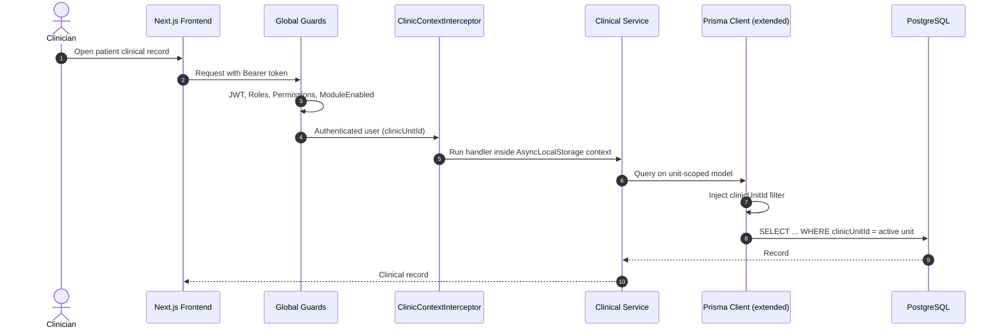

# CPAE Architecture Deep Dive

## 1. Domain Decomposition

The platform is a **Modular Monolith** built with NestJS dependency injection and its module system (34 modules at the time of writing).

### Core Modules

```
src/
├── auth/                 # JWT auth, password policy, global guards (Roles, Permissions, ModuleEnabled)
├── users/  professionals/  staff/     # User lifecycle, professional and staff records
├── clinic-units/         # ClinicUnit, UserClinicUnit, PatientClinicUnit
├── patients/             # Patient profiles, consent, intake
├── anamnesis/  clinical-records/  daily-evolutions/  clinical-opinions/
├── therapeutic-plans/  monthly-reports/  semester-reports/
├── family-feedbacks/  school-partnerships/  session-guides/  genealogy/  activity-photos/
├── appointments/         # Agenda, schedule templates, operational slots, agenda transfer
├── financial/  transactions/          # Financial operations (v1.2)
├── storage/              # StorageService: MinIO with local-disk fallback
├── document-processing/  # OCR through Google Cloud Vision
├── migration/  google-drive/          # Legacy import pipeline (Bull queues)
├── notifications/
├── ai/                   # Luna assistant (orchestrator, router, tools, guardrails, memory)
├── crm/  cms/            # Leads and public content
├── redis/
└── common/               # Clinic context (AsyncLocalStorage) and interceptor
```

There is no `tenants`, `billing`, `documents` or `queues` module, and `common/` does not hold guards, logging or transform interceptors, or exception filters. Guards live in `auth/`; the only global interceptor is the clinic-context interceptor.

## 2. Multi-Unit Isolation Strategy

### Model: shared database, `clinicUnitId` discriminator

- Unit-owned entities carry a `clinicUnitId`. Users and patients are linked to units through `UserClinicUnit` and `PatientClinicUnit`.
- The active unit is part of the authenticated user (JWT).
- A global `ClinicContextInterceptor` reads the user clinicUnitId and places it in `AsyncLocalStorage`.
- A Prisma Client extension (`$extends`) injects the `clinicUnitId` filter into queries of the models that belong to a unit, with an explicit bypass for administrative routines. Only models in an explicit list are covered.



## 3. Storage Architecture

`StorageService` wraps the MinIO SDK and falls back automatically to private local disk when MinIO is not available, so MinIO is optional. It uses a single bucket (not one per unit) and plain file names as keys. Presigned read URLs currently last 24 hours (a 15-minute target is on the hardening roadmap in the README).

Not every upload goes through `StorageService`. It is used by patients, CMS and the migration pipeline. Clinical record attachments, activity photos and professional/user images are written by Multer to the `uploads/` directory on the container volume.

## 4. Asynchronous Processing

Bull queues (Redis transport) exist in the `migration` module (`drive-import`, `ocr-processing`) and in the Luna queue service. Audit records are written synchronously. Redis also holds Luna session memory.
