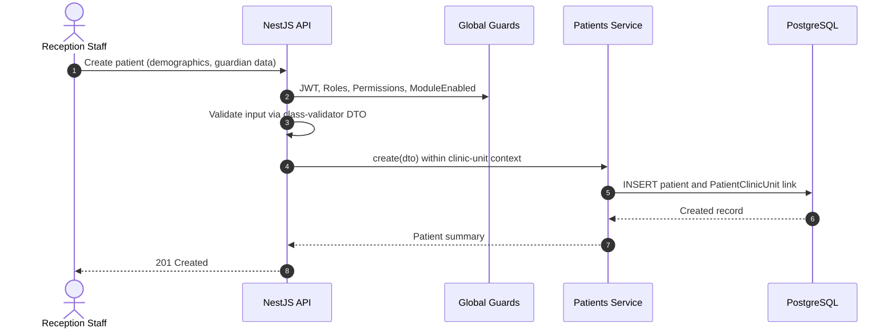

# Data Flow & Lifecycle — CPAE

## 1. Patient Intake Flow

Whether an operation writes an `AuditLog` or `AccessLog` entry is decided per service; not every operation is logged.

## 2. Clinical Evolution & Attachment Pipeline

1. **Practitioner drafts an evolution** through the web application (clinical record versions and drafts are supported).
2. **Optional attachment upload:** files are received by Multer and written to the `uploads/` directory on the container volume.
3. **Relational linkage:** file metadata and path are persisted in PostgreSQL.
4. **Storage service path:** patient, CMS and migration files go through `StorageService` (MinIO, with automatic fallback to private local disk).
5. **Reports:** monthly and semester reports and other documents are generated with `pdf-lib` and `docx` inside the request flow; there is no report queue.

## 3. Legacy Migration Pipeline

1. A Google Drive import job (`drive-import` Bull queue) fetches legacy files.
2. An OCR job (`ocr-processing` queue) sends documents to Google Cloud Vision through the `document-processing` module.
3. Results are stored through `StorageService` and linked to patients for review.

## 4. Agenda Transfer

1. A user with the `ADMIN` or `RECEPTIONIST` role calls `transfer-agenda/preview` with source and target professionals and a period.
2. The API returns affected sessions and conflicts without writing anything.
3. On execution, `onConflict` selects `ABORT`, `SKIP` or `FORCE`. `FORCE` requires an `ADMIN` or `OWNER` user, an explicit confirmation flag and a reason.
4. The frontend can export the conflict list as CSV.
