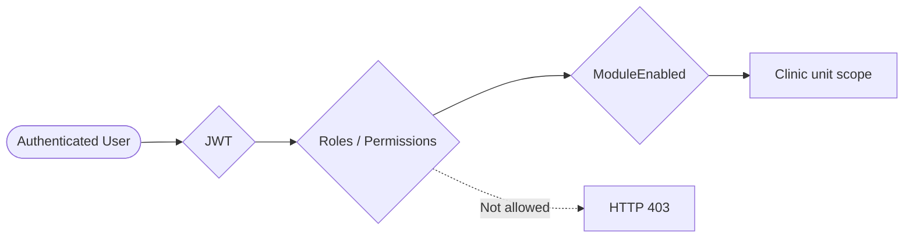

# Security & Healthcare Data Privacy — CPAE

## 1. Threat Model & Compliance Posture

Healthcare systems deal with special category data under the Brazilian LGPD:
- **Confidentiality:** patient identities, evaluations and histories must be inaccessible to unauthorized personnel, even inside the same organization.
- **Integrity:** clinical content is versioned (clinical record versions and drafts); sensitive operations are recorded in audit and access trails.
- **Availability:** the agenda and intake must remain available during clinical operating hours.

This document describes controls that exist in the code today. Items still being implemented are listed in section 5.

## 2. Role-Based Access Control

Eight roles: `ADMIN`, `OWNER`, `FINANCIAL_ADMIN`, `FINANCIAL_VIEWER`, `COORDINATOR`, `RECEPTIONIST`, `PROFESSIONAL`, `MARKETING`.

Authorization is the combination of:
- global guards: JWT, Roles, Permissions and ModuleEnabled;
- `@Roles(...)` declarations on endpoints;
- per-user module permissions (`UserModulePermission`);
- clinic-unit scoping through a Prisma Client extension.

There is no patient login. A per-endpoint role matrix is intentionally not reproduced here; the authoritative source is the `@Roles` declarations in the code. For example, the agenda transfer endpoints accept `ADMIN` and `RECEPTIONIST`, and the `FORCE` conflict policy is limited to `ADMIN` and `OWNER`.

## 3. Defense-in-Depth (current implementation)

1. **Helmet:** enabled; Content Security Policy is active only in production; HSTS follows Helmet defaults.
2. **Rate limiting:** global `@nestjs/throttler` limit of 100 requests per 60 seconds (in-memory storage), a per-account failed-login limit (100 failures in 15 minutes), and a tighter limit on the public quiz endpoint.
3. **Password security:** `bcrypt` with 10 rounds and a password policy; temporary passwords are supported for provisioned accounts.
4. **Sessions:** JWT access tokens, with the lifetime depending on the "remember me" option.
5. **Audit and access trails:** `AccessLog` on clinical-record operations; `AuditLog` on selected scheduling, permission, staff and financial operations. Not every access is logged.
6. **Consent:** `PatientConsent` records.
7. **AI redaction:** a redaction service sanitizes data in the AI layer before inference.
8. **Storage access:** files are not served from a public bucket path; read URLs from `StorageService` currently last 24 hours.

## 4. Data Residency of the AI Assistant

Luna text inference runs on a self-hosted Ollama container. OCR of legacy documents uses Google Cloud Vision, a third-party service, so the platform as a whole does not claim that no data leaves the infrastructure.

## 5. Hardening Roadmap (in progress, not yet existing behavior)

| Area | Current state | Target |
|---|---|---|
| Audit trail | Synchronous `AuditLog` writes; rows can be removed when a user is deleted | Immutable audit trail |
| Presigned URLs | 24-hour read URLs | 15-minute expiry |
| Login throttling | Global limit and per-account limit only | Per-IP login limit |
| PII in application logs | No request-log redaction layer | PII redaction in logs |
